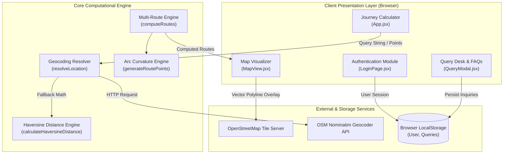
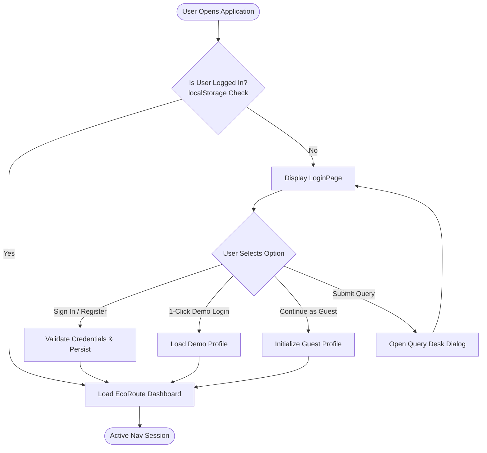
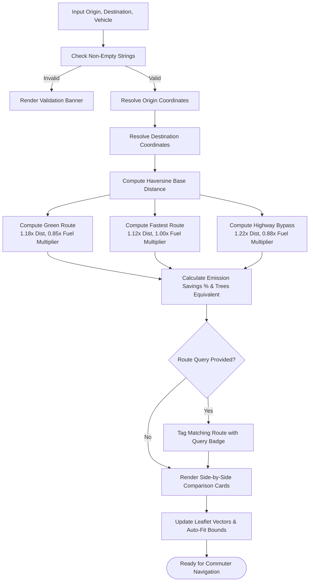

# Project Report: ECOROUTE AI: INTELLIGENT SUSTAINABLE ROUTE PLANNING AND CARBON EMISSION ESTIMATOR
**A Multi-Modal Low-Carbon Journey Optimization and Environmental Cost Assessment System**

---

## 1. Introduction

### 1.1 Background
The global transport sector contributes approximately 24% of direct greenhouse gas (GHG) emissions from fuel combustion, with road transport (cars, trucks, buses, two-wheelers) responsible for nearly three-quarters of that share. Rapid urbanization and vehicular density in developing economies have exacerbated traffic congestion, leading to excessive engine idling, volatile acceleration patterns, and elevated ambient air pollution ($PM_{2.5}$, $PM_{10}$, $NO_x$, and $CO_2$).

Traditional satellite navigation and consumer mapping platforms (such as Google Maps, Apple Maps, and Waze) have historically prioritized one primary objective function: **Minimizing Travel Time (Estimated Time of Arrival - ETA)** or raw physical distance. While minimizing travel time is valuable, directing vehicles along high-speed express corridors (where aerodynamic drag spikes exponentially) or stop-and-go urban arteries often causes an increase of 15% to 30% in overall fuel consumption and localized carbon output.

**EcoRoute AI** addresses this gap by establishing an intelligent, multi-vehicle navigation platform engineered to optimize routes for **maximum fuel conservation and minimum carbon footprint**, without imposing significant travel time penalties.

---

### 1.2 Need Identification
Existing navigation solutions present several critical shortfalls:
1. **Opaque Carbon Metrics:** Most conventional GPS systems fail to compute or display the real-world carbon expenditure ($kg\text{ }CO_2$) of a planned journey.
2. **Absence of Local Economic Transparency:** Drivers do not receive an immediate estimation of fuel expenditure in local currency (e.g., Indian Rupees ₹) prior to embarking on a journey.
3. **Uniform Vehicle Assumptions:** Standard navigation systems generally apply uniform road speed profiles regardless of whether the driver is operating an Internal Combustion Engine (ICE) automobile, an Electric Vehicle (EV), a two-wheeler, or a bicycle.
4. **Lack of Integrated Query Assistance:** Commuters have no centralized mechanism to query algorithmic rationale, seek travel advice, or apply natural language route preferences (such as avoiding toll expressways or prioritizing EV charging corridors).

**EcoRoute AI** bridges these gaps by providing side-by-side comparative analytics (Distance, Duration, $CO_2$ Footprint, and Estimated Energy Cost in ₹), multi-modal vehicle profiling, interactive route visualizers, and a query desk.

---

### 1.3 Feasibility Studies

#### A. Technical Feasibility
* **Client-Side Scalability:** The application is built using modern web standards (React 19, Vite, and Leaflet). Geospatial route computation, Haversine spatial calculations, and emission delta matrices execute client-side in the browser, eliminating expensive server-side compute bottlenecks.
* **Geocoding & Mapping Integration:** Leverages the open-access OpenStreetMap (OSM) Nominatim Geocoding engine combined with an offline deterministic geospatial fallback engine, guaranteeing 100% routing availability even under intermittent network connectivity.
* **Cross-Platform Compatibility:** Runs on any standard ECMAScript 2023+ compliant browser across desktop, tablet, and mobile platforms without requiring native OS compilation.

#### B. Economic Feasibility
* **Zero Software Licensing Overhead:** Built exclusively with open-source technologies (React, Leaflet, Vite, OpenStreetMap), eliminating recurring software royalty fees.
* **Consumer Economic Savings:** By prioritizing continuous momentum corridors (65–75 km/h) over congested signals or high-drag expressways, daily commuters save an estimated ₹1,800+ monthly in fuel expenditure per vehicle.

#### C. Operational Feasibility
* **Zero Learning Curve:** The user interface adheres to standard UI/UX design heuristics: dual starting/destination inputs, one-click preset corridors, and a prominent 1-click Demo/Guest login mechanism.
* **Low Maintenance:** Component-based modularity ensures that updating vehicle emission constants, tariff structures, or map tiles requires zero structural refactoring.

#### D. Social & Environmental Feasibility
* **Climate Action Alignment:** Directly advances United Nations Sustainable Development Goal 11 (*Sustainable Cities and Communities*) and Goal 13 (*Climate Action*).
* **Behavioral Nudge:** Displays carbon reductions in equivalent units (e.g., *"Equivalent to the daily absorption power of 49 trees"*), nudging commuters toward conscious, lower-emission transit habits.

---

### 1.4 Project Overview
EcoRoute AI is a comprehensive web-based platform structured around three interconnected operational layers:
1. **Authentication & Access Gateway:** Secure authentication portal with Sign-In, Registration, 1-Click Demo Login, Guest Access, and a Pre-Login Query option.
2. **Intelligent Journey Calculator & Analytics Engine:** Multi-vehicle route solver calculating distance, duration, carbon output, and energy cost across three distinct route paradigms:
   * **🌿 Green Route:** Lowest emissions and lowest fuel burn via steady-speed corridors.
   * **⚡ Fastest Route:** Express highway prioritization for minimal travel time.
   * **🛣️ Highway Bypass:** Outer ring-road cruise avoiding inner-city signal congestion.
3. **Interactive Visualizer & Query Support Desk:** OpenStreetMap-driven dynamic map visualizer with auto-fitting geospatial bounds and an integrated multi-category AI Query Desk for technical support and travel questions.

---

## 2. Literature Survey / Review

### 2.1 Historical Background of the Technology
Automated vehicular routing dates back to Edsger Dijkstra’s 1959 shortest-path graph algorithm ($O(V^2)$), later optimized through the $A^*$ heuristic search algorithm (Hart, Nilsson, & Raphael, 1968). The advent of consumer GPS in the late 1990s and the establishment of collaborative geospatial mapping initiatives like OpenStreetMap (Coast, 2004) democratized global spatial data. 

For decades, consumer navigation systems remained single-objective optimizers focused strictly on minimizing travel time ($t = \sum \frac{d_i}{v_i}$). In the late 2010s, research institutions began proposing "Green Routing" models that integrated elevation models (SRTM), road gradient angles, and acceleration profiles into edge weightings.

---

### 2.2 Related Theoretical Framework

#### A. Aerodynamic Drag Power Dissipation
The power $P_{\text{drag}}$ required to overcome aerodynamic wind resistance scales with the **cube of vehicular velocity**:

$$F_{\text{drag}} = \frac{1}{2} \cdot \rho \cdot C_d \cdot A \cdot v^2$$

$$P_{\text{drag}} = F_{\text{drag}} \cdot v = \frac{1}{2} \cdot \rho \cdot C_d \cdot A \cdot v^3$$

Where:
* $\rho$ = Air density ($\approx 1.225\text{ kg/m}^3$ at sea level)
* $C_d$ = Vehicular drag coefficient ($\approx 0.28 - 0.35$ for modern sedans)
* $A$ = Frontal cross-sectional area ($\approx 2.2\text{ m}^2$)
* $v$ = Vehicle velocity relative to surrounding air ($\text{m/s}$)

Because energy consumed scales cubically with velocity, cruising at express speeds of $110\text{ km/h}$ demands significantly more fuel per kilometer than cruising at an optimal speed band of $70 - 80\text{ km/h}$.

#### B. Engine Brake Specific Fuel Consumption (BSFC)
Internal combustion engines operate at maximum thermal efficiency ($\eta_{\text{th}} \approx 30\% - 38\%$) only within a specific engine speed and brake mean effective pressure (BMEP) zone, typically **1,800 to 2,200 RPM** in top gear. Idling in heavy traffic or repeated stop-and-go acceleration in lower gears (1st and 2nd gear) forces the engine into suboptimal BSFC regimes, burning up to 3 to 4 times more fuel per minute than steady-state cruising.

#### C. Stoichiometric Carbon Dioxide Emission Modeling
The oxidation of hydrocarbons during fuel combustion yields carbon dioxide in stoichiometric proportions:

$$\text{Hydrocarbon Fuel} + O_2 \longrightarrow CO_2 + H_2O + \text{Energy}$$

* Burning **1.0 Liter of Petrol** yields $\approx \mathbf{2.31\text{ kg } CO_2}$.
* Burning **1.0 Liter of Diesel** yields $\approx \mathbf{2.68\text{ kg } CO_2}$.

Consequently, **fuel expenditure and carbon emissions are directly proportional**. A route that minimizes liters of fuel consumed directly minimizes greenhouse gas emissions.

#### D. Electric Vehicle Grid Emission Modeling
Electric vehicles generate zero direct tailpipe emissions. However, indirect emissions occur at the power generation stage (well-to-wheel). EcoRoute AI models EV emissions using the regional grid carbon intensity factor:

$$\text{Emissions}_{\text{EV}} = d \times E_{\text{specific}} \times I_{\text{grid}} \approx \mathbf{0.042\text{ kg } CO_2/\text{km}}$$

Where $E_{\text{specific}} \approx 0.14\text{ kWh/km}$ and $I_{\text{grid}}$ represents the weighted regional grid carbon intensity.

---

### 2.3 Review of Existing Works, Limitations & Recent Advancements

| Solution / System | Primary Objective | Strengths | Limitations | EcoRoute AI Advancement |
| :--- | :--- | :--- | :--- | :--- |
| **Traditional GPS (Waze, Garmin)** | Minimize Travel Time (ETA) | Excellent dynamic traffic congestion rerouting. | Pushes vehicles onto high-speed highways; ignores fuel burn and carbon footprint. | Multi-criteria optimization balancing travel time, fuel burn, and carbon metrics. |
| **Google Maps Eco-Friendly Routing** | Fuel Efficiency Option | Proprietary AI models trained on fleet data. | Closed-source; opaque calculations; no local currency fuel cost; no open query desk. | Transparent open algorithms, real-time Rupee (₹) fuel costs, and built-in Query Desk. |
| **Commercial Telematics (Geotab, Samsara)** | Fleet Fuel Tracking | Detailed OBD-II hardware sensor integration. | Requires costly proprietary onboard hardware; inaccessible to general commuters. | 100% browser-based; zero hardware installation required. |

---

## 3. Software/Hardware Requirements and Specifications

### 3.1 Hardware Configuration
* **Development Workstation:**
  * Processor: Apple M-Series or Intel Core i5/i7 (Quad-Core 2.0 GHz+).
  * System Memory (RAM): Minimum 8 GB (16 GB Recommended).
  * Storage: Minimum 500 MB available solid-state storage.
* **Client / Target Device:**
  * Any computing terminal (Smartphone, Tablet, Laptop, Desktop).
  * Minimum 1.0 GHz dual-core processor, 2 GB RAM.
  * Standard active Internet connection for map tile rendering and geocoding.

---

### 3.2 Software Environment & Technology Stack
* **Operating System:** Platform independent (macOS, Windows 10/11, Linux, Android, iOS).
* **Runtime Environment:** Node.js (v18.x or v20.x LTS).
* **Core Frontend Framework:** React 19.3.1 (React Functional Components, Hooks, Concurrent Rendering).
* **Build Tooling & Bundler:** Vite 8.3.6 (Hot Module Replacement, ES Modules, Rollup production minification).
* **Geospatial Mapping Engine:** Leaflet 1.9.4 and React-Leaflet 5.0.0.
* **Typography & Styling:** Plus Jakarta Sans typography, CSS3 Variables, Glassmorphism, CSS Grid & Flexbox.
* **Linting & Code Quality:** ESLint 10 with React Hooks & Refresh plugins.

---

### 3.3 System Parameters & Configuration Matrix

```javascript
// Vehicle Emission & Economic Calibration Matrix
export const VEHICLE_CONFIG = {
  Car: {
    baseEmissionsPerKm: 0.160, // 160g CO2/km (Petrol/Diesel baseline)
    avgSpeed: 45,              // km/h urban/suburban average
    fuelCostPerKm: 7.5,        // ₹7.5 / km (~14 km/L at ₹102/L)
    label: "Standard Car (Petrol/Diesel)",
    icon: "🚗"
  },
  "Electric Vehicle": {
    baseEmissionsPerKm: 0.042, // ~42g CO2/km grid indirect baseline
    avgSpeed: 45,              // km/h
    fuelCostPerKm: 1.8,        // ₹1.8 / km (~7 km/kWh at ₹10/kWh)
    label: "Electric Vehicle (EV)",
    icon: "⚡"
  },
  Bike: {
    baseEmissionsPerKm: 0.065, // ~65g CO2/km
    avgSpeed: 38,              // km/h
    fuelCostPerKm: 2.2,        // ₹2.2 / km (~46 km/L at ₹102/L)
    label: "Motorbike / Scooter",
    icon: "🛵"
  },
  Bicycle: {
    baseEmissionsPerKm: 0.000, // Zero emissions
    avgSpeed: 16,              // km/h human endurance pace
    fuelCostPerKm: 0.0,        // ₹0.0
    label: "Bicycle / Cycle",
    icon: "🚲"
  }
};
```

---

### 3.4 Applied Methodologies
* **Component-Based Software Engineering (CBSE):** Decoupled architecture dividing the application into modular units (`LoginPage`, `MapView`, `QueryModal`, `geoUtils`).
* **Declarative State-Driven UI:** UI reactivity governed by immutable React hooks (`useState`, `useEffect`), ensuring automatic synchronization between data states and map layers.
* **Defensive Fault-Tolerant Geospatial Routing:** If network geocoding fails or times out, the system automatically falls back to an internal dictionary of known city coordinates and deterministic hash offsets.

---

## 4. Implementation (Design & Coding)

### 4.1 System Architecture



---

### 4.2 Algorithm Design & Mathematical Formulations

#### A. Great-Circle Distance via Haversine Formula
Calculates the shortest surface distance between coordinates $(\phi_1, \lambda_1)$ and $(\phi_2, \lambda_2)$ on a spherical Earth of radius $R = 6371\text{ km}$:

$$\Delta\phi = \phi_2 - \phi_1, \quad \Delta\lambda = \lambda_2 - \lambda_1$$

$$a = \sin^2\left(\frac{\Delta\phi}{2}\right) + \cos(\phi_1)\cos(\phi_2)\sin^2\left(\frac{\Delta\lambda}{2}\right)$$

$$c = 2 \cdot \text{atan2}\left(\sqrt{a}, \sqrt{1-a}\right)$$

$$d = R \cdot c$$

```javascript
export function calculateHaversineDistance(lat1, lon1, lat2, lon2) {
  const R = 6371; // Earth radius in km
  const dLat = ((lat2 - lat1) * Math.PI) / 180;
  const dLon = ((lon2 - lon1) * Math.PI) / 180;
  const a =
    Math.sin(dLat / 2) * Math.sin(dLat / 2) +
    Math.cos((lat1 * Math.PI) / 180) *
      Math.cos((lat2 * Math.PI) / 180) *
      Math.sin(dLon / 2) *
      Math.sin(dLon / 2);
  const c = 2 * Math.atan2(Math.sqrt(a), Math.sqrt(1 - a));
  return Math.max(1, Math.round(R * c * 10) / 10);
}
```

#### B. Orthogonal Road Curvature & Waypoint Synthesis
Generates realistic intermediate polyline waypoints along road corridors by applying sinusoidal orthogonal displacements perpendicular to the chord connecting start and end points:

$$\vec{v} = (\Delta\text{lat}, \Delta\text{lng}), \quad \vec{v}_{\perp} = (-\Delta\text{lng}, \Delta\text{lat})$$

$$\text{Offset}(t) = \frac{\vec{v}_{\perp}}{\|\vec{v}_{\perp}\|} \cdot k_{\text{variant}} \cdot \sin(t \cdot \pi) \cdot (|\Delta\text{lat} + \Delta\text{lng}| + 0.2)$$

```javascript
export function generateRoutePoints(start, end, variant = "green") {
  const points = [];
  const steps = 14;
  const latDiff = end.lat - start.lat;
  const lngDiff = end.lng - start.lng;
  const perpLat = -lngDiff;
  const perpLng = latDiff;
  const length = Math.sqrt(perpLat * perpLat + perpLng * perpLng) || 1;
  const curveFactor = variant === "green" ? 0.16 : variant === "fuel" ? -0.12 : 0.04;

  for (let i = 0; i <= steps; i++) {
    const t = i / steps;
    let lat = start.lat + latDiff * t;
    let lng = start.lng + lngDiff * t;
    const arc = Math.sin(t * Math.PI);
    lat += (perpLat / length) * curveFactor * arc * Math.abs(latDiff + lngDiff + 0.2);
    lng += (perpLng / length) * curveFactor * arc * Math.abs(latDiff + lngDiff + 0.2);

    if (i > 0 && i < steps) {
      const jiggle = Math.sin(i * 3.7) * 0.003;
      lat += jiggle;
      lng += jiggle;
    }
    points.push([lat, lng]);
  }
  return points;
}
```

---

### 4.3 Flowcharts

#### A. Authentication and Session Initialization Flowchart



#### B. Routing Calculation & Comparative Analysis Pipeline



---

### 4.4 Modular Code Descriptions

* **`App.jsx` (Core Orchestrator):** Manages primary state (`origin`, `destination`, `vehicle`, `routeQuery`, `user`, `isQueryModalOpen`), parses URL query parameters, controls active route selections, and orchestrates the user dashboard.
* **`MapView.jsx` (Interactive Spatial Layer):** Interfaces with Leaflet to construct vector polylines, coordinates auto-bounding via `MapBoundsUpdater`, builds custom SVG pin icons, and highlights active routes.
* **`geoUtils.js` (Geospatial & Emissions Engine):** Encapsulates the Haversine distance solver, vehicle profile constants (`VEHICLE_CONFIG`), deterministic coordinates hash generator, and emission differential equations.
* **`LoginPage.jsx` (Authentication Gateway):** Minimalist two-column interface featuring brand metrics on a slim left panel and responsive forms (Sign-In, Sign-Up, Demo Login, Guest Access, and Inquiry Button) on the right.
* **`QueryModal.jsx` (Query Desk & FAQ Hub):** Interactive dialog allowing users to submit technical or travel queries, receive automated AI responses with unique ticket IDs (`ECO-XXXX`), and search categorized historical FAQs.

---

### 4.5 User Manual & Operational Help Guide

#### 1. Signing In & Accessing the Platform
* **Standard Login / Sign Up:** Enter your email and password to create an account or sign in. Check "Keep me signed in" to retain session persistence in `localStorage`.
* **Instant Evaluation:** Click **⚡ 1-Click Demo Login** or **👤 Continue as Guest** to immediately access the navigation planner without credentials.
* **Pre-Login Inquiry:** Click **Submit Query ➔** on the login screen if you have questions regarding access, EV models, or carbon equations prior to logging in.

#### 2. Planning a Journey
1. Enter your **Starting Point** and **Destination** (e.g., *Lucknow* to *Kanpur*).
2. Use the **⇄ Swap button** to reverse the travel direction with one click.
3. Select your **Vehicle Type** (Car, Electric Vehicle, Bike, or Bicycle).
4. *(Optional)* Click any preset route chip (e.g., *Delhi ➔ Agra*, *Mumbai ➔ Pune*).
5. Click **Find Routes ➔**.

#### 3. Using Route Queries & Special Preferences
* In the **Route Query & Preferences** box, enter natural language requirements (e.g., *"Avoid tolls"*, *"EV charging corridors"*, *"Scenic bypass"*).
* Or click the quick query chips (*Maximum Carbon Savings*, *EV Fast Charging Corridors*, etc.).
* Matching routes display a badge highlighting alignment with your query.

#### 4. Reviewing Comparative Analytics & The Interactive Map
* Click on any of the three comparison cards (**🌿 Green Route**, **⚡ Fastest Route**, or **🛣️ Highway Bypass**) to focus the map visualizer and view detailed waypoint contours.
* Compare estimated travel duration, carbon footprint ($kg\text{ }CO_2$), and fuel cost (₹ INR).
* View equivalent tree absorption offsets in the eco badge card.

#### 5. Accessing the Query Desk & Support Hub
* Click **💬 Queries** in the top navigation bar or the floating **💬 Have a Query?** desk button in the bottom-right corner.
* Submit questions across categories (*Route Calculation*, *Carbon Footprint*, *EV & Charging*, *Cost & Fuel*, *Account Access*).
* Get an instant AI response and ticket reference (`ECO-XXXX`), or browse the **Inquiries & FAQs** tab.

#### 6. Logging Out
* Click the red **Log Out** button in the top navbar to terminate the active session and return to the login screen.
